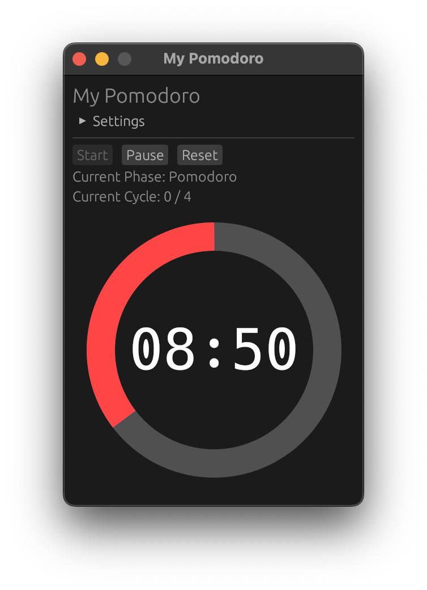

# MyPomodoro

A simple Pomodoro timer application built with Rust and egui.


## Features

- Customizable work and break durations
- Visual timer display with doughnut-shaped progress indicator
- Dynamic window icon that shows timer progress in dock/taskbar
- Sound notifications when phases complete
- Simple and intuitive interface

## Building from Source

### Prerequisites

- Rust and Cargo: <https://www.rust-lang.org/tools/install>
- cargo-bundle: `cargo install cargo-bundle`

### Building for Windows

To build a Windows executable bundle (.exe/.msi):

```bash
# On Windows
./build.bat

# On any platform with cross-compilation setup
./build.sh --windows
```

The Windows bundle will be created in `target/release/bundle/msi/`.

### Building for macOS

To build a macOS application bundle (.app):

```bash
# On macOS
./build.sh --macos

# On any platform with cross-compilation setup
./build.sh --macos
```

The macOS bundle will be created in `target/release/bundle/osx/`.

### Building for All Platforms

To build for all supported platforms:

```bash
./build.sh --all
```

## Testing the Generated Bundles

### Windows (.exe/.msi)

1. Navigate to `target/release/bundle/msi/`
2. Run the installer (.msi) file
3. Launch the application from the Start Menu
4. Verify that:
   - The application launches correctly
   - The timer functions properly
   - Sound notifications work when a phase completes
   - Settings can be adjusted

### macOS (.app)

1. Navigate to `target/release/bundle/osx/`
2. Open the .app bundle
3. If prompted about an unidentified developer, right-click the app and select "Open"
4. Verify that:
   - The application launches correctly
   - The timer functions properly
   - Sound notifications work when a phase completes
   - Settings can be adjusted

## Platform-Specific Considerations

### Windows

- The application uses the Windows subsystem flag to prevent console windows from appearing
- Icons are automatically converted to the appropriate format (.ico)
- The installer includes necessary metadata for proper installation

### macOS

- The application is bundled as a standard .app package
- Icons are automatically converted to the appropriate format (.icns)
- The bundle includes proper metadata for macOS application requirements
- Minimum supported macOS version is 10.13 (High Sierra)

## Cross-Platform Audio

The application uses the `rodio` crate for cross-platform audio playback, ensuring sound notifications work consistently across different operating systems.

## Development

### Running with Logging

The application uses the `log` crate for logging. To view logs during development or troubleshooting, set the `RUST_LOG` environment variable:

```bash
# Show all logs (info, debug, trace)
RUST_LOG=debug cargo run

# Show only info and warning logs
RUST_LOG=info cargo run

# Show logs from specific modules
RUST_LOG=mypomodoro=debug cargo run
```

The application logs useful information including:

- Icon updates (every second when timer is running)
- Phase transitions (Pomodoro → Break, etc.)
- Timer state changes (start, pause, resume, reset)

### Running in Release Mode

For better performance during development:

```bash
cargo run --release
```

## Licenses and Attribution

### Third-Party Resources

This application includes the following third-party resources:

- **Sound effect**: Bell sound from [Springin' Sound Stock](https://www.springin.org/sound-stock/)
- **Font**: DejaVu Sans Mono font
  - Copyright: (c) 2003 by Bitstream, Inc. All Rights Reserved.
  - Bitstream Vera is a trademark of Bitstream, Inc.
  - License: [Bitstream Vera License / Arev Fonts License](https://dejavu-fonts.github.io/License.html)
  - The DejaVu fonts are free software and may be redistributed and modified under the terms of the license.
  - Source: [DejaVu Fonts Project](https://dejavu-fonts.github.io/)
